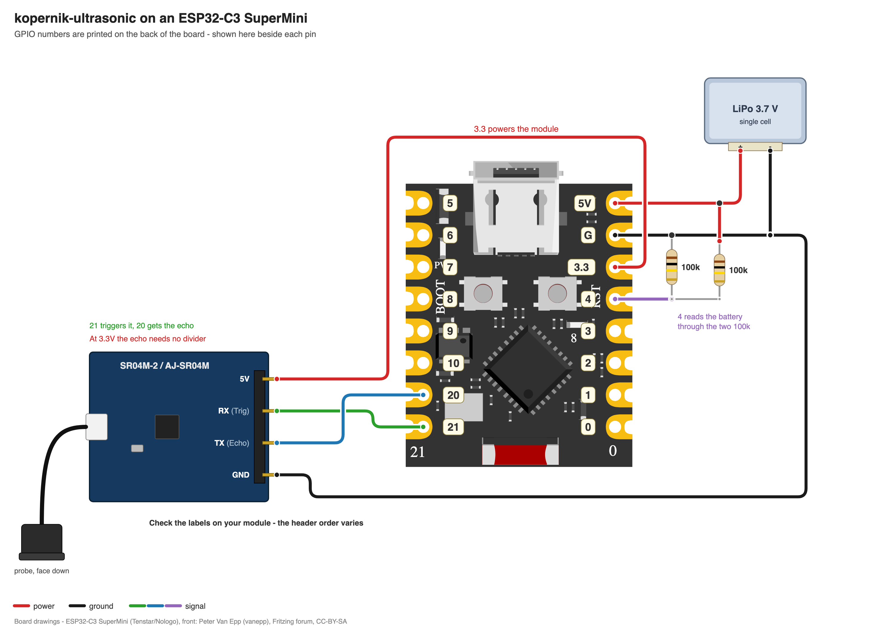
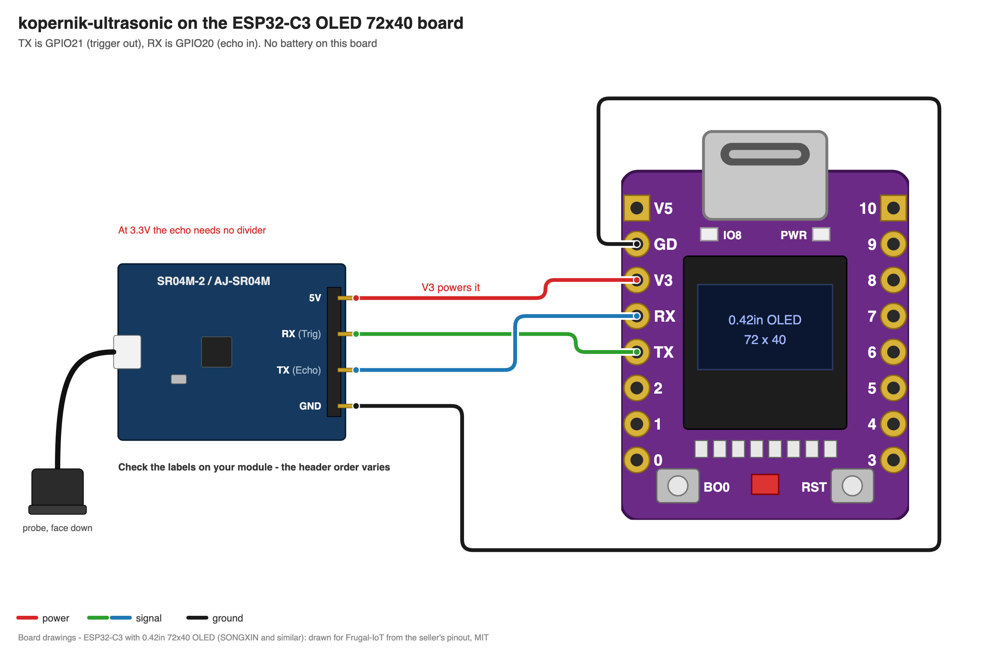

# kopernik-ultrasonic

An ultrasonic water level sensor on an ESP32-C3 SuperMini, or on an ESP32-C3 board with a small
72x40 OLED. It reports the distance down to the water to the Frugal-IoT dashboard, and the OLED
board also shows it on its screen. Settings are in the configuration block at the top of
`kopernik-ultrasonic.ino`.

It is set up for the waterproof **SR04M-2** or **AJ-SR04M** as shipped, in trigger/echo mode,
**powered from 3V3**. At 3.3V the module's echo is 3.3V too, so it goes straight to the ESP's pin
with no resistors. At 3.3V the module also needs a longer trigger pulse, which `platform.h` and
`platformio.ini` set.

## Wiring

The two modules label their header differently. Check the labels on yours, as the order varies.

| SR04M-2 | AJ-SR04M | SuperMini | C3 OLED board |
|---|---|---|---|
| 5V | VCC | 3.3 | V3 |
| GND | GND | G | GD |
| RX | Trig | 21 | TX (GPIO21) |
| TX | Echo | 20 | RX (GPIO20) |

The SR04M-2's pin is printed 5V, but it is fed 3.3V here.

### ESP32-C3 SuperMini, or SuperMini Pro



The GPIO numbers are printed on the back of the board. The battery is wired as on kopernik-soil:
the two 100k resistors halve its voltage so that pin 4 can read it.

### ESP32-C3 OLED 72x40, no battery



This board prints every pin on the front. It has no battery, so it runs from USB.

## Mounting - read this before trusting a reading

The module has one transducer, which sends and then listens. A wall right beside its face, such
as the inside of a pipe or a cap, gives a fixed false reading of about 25cm whatever the real
distance. Either keep the face just above the top of the pipe, or line the top 100mm of the pipe
with something soft that soaks up sound. Outdoors, where it may get wet, use a synthetic
(polyester) felt or foam sold for outdoor acoustic use. Do not put anything across the face.

Before trusting it, move the target and check the reading moves with it. Readings closer than
200mm are inside the module's blind zone and are thrown away.

## Building

| | PlatformIO | Arduino IDE, Tools > Board |
|---|---|---|
| SuperMini | `pio run -e supermini -t upload` | **Nologo ESP32C3 Super Mini** |
| C3 OLED 72x40 | `pio run -e c3_oled_72x40_nobatt -t upload` | **LOLIN C3 Mini** |

**Arduino IDE.** Install **Frugal-IoT** 2.0.13 or later with Tools > Manage Libraries, and
choose **Install All** when it asks about dependencies. Also install the **esp32** boards package.
On either board set Tools > Partition Scheme to **No OTA (2MB APP/2MB SPIFFS)**. Despite its
name, over-the-air updates keep working: `partitions.csv` sets the real layout, and the menu only
raises the size limit the IDE checks against. Keep every file in this folder together:
`platform.h` holds settings the library itself reads, and `partitions.csv` makes the build fit.

**Enrolment secret.** The secret lets the node join the dashboard by itself. Get it from the
dashboard's gear icon > Nodes > Enrolment secret.

In the Arduino IDE, paste it between the quotes on the `SYSTEM_MQTT_ENROL_SECRET` line of `kopernik-ultrasonic.ino`.

In PlatformIO, create `platformio-secrets-local.ini` beside `platformio.ini` containing:
```
    [common]
    build_flags_secrets = '-D SYSTEM_MQTT_ENROL_SECRET="paste-it-here"'
```
Without a secret the node waits on the Nodes card for an administrator to approve it. Either way,
do not share or commit a copy that has the secret in it.

## Depth instead of distance

The node publishes the distance from the module's face down to the water, in mm. For the depth of
water instead, measure the height of the face above the bottom of the tank and use the commented
**Depth** lines in `kopernik-ultrasonic.ino` in place of the **Distance** ones, with that height.

## Diagrams

`docs/wiring.py` draws both, using the wiring-diagrams skill. Board drawing for the SuperMini:
Peter Van Epp (vanepp), Fritzing forum, CC-BY-SA.
